# Autodesk Inventor Automation Engine v2.2

[](https://github.com/MelvinjoseC/Inventor-Automation/actions/workflows/ci.yml)
[](https://www.python.org/)
[-lightgrey.svg)](https://www.microsoft.com/windows)
[](LICENSE)
[](https://github.com/psf/black)

A modular, enterprise-grade Autodesk Inventor automation platform built in Python. Designed for automated CI/CD pipelines, manufacturing execution systems, and batch CAD engineering, this engine programmatically synthesizes 3D parametric components, assembles multi-part mechanisms with physical constraints and occurrence patterning, evaluates 3D collision interference, lays out technical drawings with automated parts lists and item balloons, estimates manufacturing stock and machining cost, performs automated Design Rule Checking (DRC), and packages models into cryptographically verified release archives (STEP, STL, DWG, DXF, PDF, PNG, SHA-256).

---

## Architecture Overview

```mermaid
graph LR
    subgraph IN ["Input Specifications"]
        BOM["Structured BOM (CSV / JSON / YAML)"]
        CLI["Enterprise CLI"]
        ENV["Environment & Config"]
    end

    subgraph ENGINE ["Automation Core"]
        MGR["Connection & Transactions"]
        CAD["Parametric Modeling & Holes"]
        ASM["Assembly Engine, Patterns & Interference"]
        DRC["DRC & Mass Properties Inspector"]
        COST["Stock & Machining Cost Estimator"]
        DRW["Drawing, Balloons & Revision Table"]
    end

    subgraph OUT ["Manufacturing Deliverables"]
        MODELS["3D Models (.ipt, .iam)"]
        SHEETS["2D Drawings (.idw, .pdf, .dwg)"]
        FAB["CNC / 3D Print (.step, .stl, .dxf)"]
        REP["Audit Reports (HTML / Markdown)"]
        PKG["Release Bundle (.zip + SHA-256 Manifest)"]
    end

    IN --> ENGINE
    ENGINE --> OUT
```



For a technical deep-dive into COM threading, memory models, transaction management, and collision detection, refer to the [Architecture Guide](docs/ARCHITECTURE.md).

---

## Key Capabilities

1. **Multi-Primitive Parametric Modeling**:
   - **Primitives**: Blocks, Cylinders, Mounting Plates with automated bolt circle/corner hole patterns, Concentric Tubes/Pipes, Hexagonal Fasteners (`create_hex_fastener`), Stepped Shafts (`create_stepped_shaft`), Structural L-Brackets (`create_l_bracket`), and Circular Mounting Flanges (`create_circular_flange`).
   - **Hole Engineering**: Parametric clearance drills, counterbore pockets for socket head screws, and tapped threads (`create_hole_feature`).
   - **Feature Modifications**: Constant radius fillets, chamfers, and subtractive extrude pockets.
   - **Dynamic Parameters**: `ParameterManager` enabling formulaic dimension updates with automatic document regeneration.

2. **Assembly Automation & Constraints (`AssemblyAutomationEngine`)**:
   - Automated component placement with 3D translation matrix positioning.
   - Occurrence patterning: 1D/2D rectangular arrays and polar circular arrays.
   - Grounding management and constraint automation: Mate, Flush, and Insert constraints.
   - **Automated Collision Analysis**: `check_interference` executes volumetric collision checks via Inventor's `AnalyzeInterference` API.
   - Programmatic extraction of structured assembly BOMs.

3. **Intelligent Technical Drawings (`DrawingGenerator`)**:
   - Automated orthographic view layouts (Front, Top, Right) and shaded Isometric projection.
   - Dynamic view scale calculation (`calculate_auto_scale`) fitting models cleanly within sheet bounds.
   - Sheet standard support (A0–A4, ANSI A–E).
   - Automated center marks, item callout balloons (`_add_balloons`), and revision history tables (`_add_revision_table`).
   - Dynamic Parts List (BOM Table) generation and title block metadata synchronization.

4. **Automated Design Rule Checking (`ModelInspector`)**:
   - Extracts mass, volume, surface area, bounding box extents, and center of gravity.
   - Evaluates manufacturability: minimum wall thickness, aspect ratio constraints, hole-to-edge clearances, machine build envelopes, and mass budget limits.

5. **Manufacturing Stock & Cost Estimation (`CostEstimator`)**:
   - Volumetric raw billet sizing with configurable machining margins.
   - Material scrap chip volume and percentage calculation.
   - Machining cycle time estimation based on volumetric Material Removal Rates (MRR).
   - Itemized material, machining, and total fabrication cost estimation for steel, aluminum, brass, and titanium.

6. **Universal CAD Translation & Release Bundler (`InventorExporter`)**:
   - 3D Exchange: STEP (AP214 / AP203), IGES, SAT.
   - Additive Manufacturing: STL with resolution control.
   - 2D Technical Documentation: Vector PDF and AutoCAD DWG/DXF.
   - High-Resolution Viewport Image Snapshots (PNG / JPEG) up to 4K.
   - **Cryptographic Release Packaging**: Generates versioned ZIP bundles containing CAD files, drawings, exports, and an automated `MANIFEST.json` with SHA-256 checksums.

7. **Executive Audit Reporting (`RunReporter`)**:
   - Generates interactive, styled HTML manufacturing dashboards with KPI metric cards and status badges.
   - Compiles GitHub-Flavored Markdown summaries suitable for CI step summaries and pull request comments.

8. **Enterprise Resilience & DevOps Integration**:
   - **Transaction Safety**: Atomic `TransactionContext` prevents partial or corrupted file writes by automatically rolling back aborted operations.
   - **High-Throughput Performance**: `PerformanceMode` disables UI screen updating and prompts during heavy batch processing.
   - **Cross-Platform Headless Testing**: 100% mocked COM test suite (`pytest`) executing across Python 3.9–3.12 on Windows and Linux runners without requiring an Autodesk Inventor license.

---

## Directory Structure

```text
Inventor-Automation/
├── .github/
│   └── workflows/
│       └── ci.yml                   # Matrix CI/CD workflow (Windows + Linux, Py 3.9-3.12)
├── config/
│   ├── config.json                  # Central system configuration
│   ├── sample_bom.json              # Standard component BOM
│   ├── sample_assembly_bom.json     # Multi-part assembly BOM specification
│   ├── sample_machined_parts.csv    # Machined parts specification (CSV)
│   └── sample_machined_parts.yaml   # Multi-primitive machined parts BOM (YAML)
├── docs/
│   └── ARCHITECTURE.md              # Deep dive on COM architecture, collision & transactions
├── src/
│   ├── core/
│   │   ├── assembly_engine.py       # Assembly modeling, occurrence patterns & interference
│   │   ├── bom_processor.py         # Multi-primitive BOM ingestion (JSON, CSV, YAML)
│   │   ├── config_loader.py         # Environment overrides & schema validator
│   │   ├── connection.py            # COM session, PerformanceMode & TransactionContext
│   │   ├── cost_estimator.py        # Raw billet sizing, scrap % & machining cost estimator
│   │   ├── drawing_generator.py     # Drawing layouts, scale auto-fit, balloons & revision tables
│   │   ├── exporter.py              # STEP, STL, DWG, PDF exports & SHA-256 release bundler
│   │   ├── inspector.py             # Physical properties & advanced DRC rules
│   │   ├── logger.py                # Console & file logging engine
│   │   ├── parameters.py            # Parametric user equations & dimensions
│   │   ├── properties.py            # Standard and custom iProperties metadata
│   │   └── reporter.py              # HTML dashboard & Markdown reporting
│   ├── automation.py                # Core 3D geometry engine (primitives, revolves, holes)
│   ├── cli.py                       # Unified command-line interface
│   ├── diagnose.py                  # Environment & COM registry diagnostics
│   ├── inventor_hello.py            # Session verification script
│   └── inventor_make_block.py       # Parametric modeling demo script
├── tests/
│   ├── test_advanced_features.py    # Interference, balloons, scale, cost & bundler tests
│   ├── test_advanced_primitives.py  # Hex fasteners, stepped shafts, flanges & hole tests
│   ├── test_assembly_engine.py      # Assembly engine & constraint tests
│   ├── test_bom_processor.py        # BOM parsing & unit conversion tests
│   ├── test_cli.py                  # CLI argument & command routing tests
│   ├── test_com_mock.py             # COM interface & modeling mock tests
│   ├── test_config_loader.py        # Config loader & env override tests
│   ├── test_e2e_pipeline.py         # End-to-end pipeline integration tests
│   ├── test_extended_exporter.py    # STEP, STL, and raster export tests
│   ├── test_inspector.py            # DRC rules & physical property tests
│   ├── test_parameters_and_properties.py # Parameter & iProperty tests
│   └── test_reporter.py             # HTML/Markdown reporter tests
├── .pre-commit-config.yaml          # Developer quality gates (Black, Flake8, Hooks)
├── CHANGELOG.md                     # Release history & feature changelog
├── LICENSE                          # Official MIT License
├── pyproject.toml                   # Project packaging & tool configuration
├── requirements.txt                 # Dependencies list
└── README.md                        # Documentation
```

---

## Installation & Setup

### Prerequisites
- **OS**: Windows 10/11 or Windows Server (required for live Autodesk Inventor COM interop). Linux supported for headless mocked test execution.
- **Software**: Autodesk Inventor (2020 or newer).
- **Python**: Python 3.8 to 3.12.

### Step-by-Step Installation
1. Clone the repository:
   ```bash
   git clone https://github.com/MelvinjoseC/Inventor-Automation.git
   cd Inventor-Automation
   ```

2. Install dependencies:
   ```bash
   pip install -r requirements.txt
   ```

3. Verify environment and COM registration:
   ```bash
   python src/cli.py diagnose
   ```

---

## Command Line Interface (CLI) Usage

### 1. Generating Parametric Parts
Create a cylinder with chamfered edges and export to STEP, PDF, and STL:
```bash
python src/cli.py generate-part --type cylinder --diameter 40 --length 150 --unit mm --chamfer-distance 2.0 --part-number CYL-001 --name "Drive Shaft" --export step,stl,pdf --inspect
```

Create a mounting plate with corner bolt pattern:
```bash
python src/cli.py generate-part --type plate_with_holes --width 120 --height 90 --thickness 12 --hole-diameter 10 --unit mm --fillet-radius 4.0 --part-number PL-101 --name "Motor Bracket" --export step,dwg,pdf
```

### 2. Processing Batch BOMs (JSON, CSV, or YAML)
Batch generate parts, technical drawings, and exports directly from specifications:
```bash
python src/cli.py process-bom --bom-file config/sample_machined_parts.yaml --export step,stl,pdf,dwg --inspect
```

### 3. Assembly Synthesis & Collision Detection
Assemble components into an IAM document and construct an assembly drawing with an automated Parts List and balloons:
```bash
python src/cli.py create-assembly --assembly-number ASM-100 --name "Main Fixture" --components "output/ASM-BASE-01.ipt,output/ASM-POST-02.ipt" --export step,pdf
```

Check 3D interference and collisions across all assembly occurrences:
```bash
python src/cli.py check-interference --assembly output/MainAssembly.iam
```

### 4. Part Inspection & Cost Estimation
Perform physical mass property inspection and design rule checks on an existing part:
```bash
python src/cli.py inspect --file output/Block.ipt
```

Estimate raw stock billet dimensions, chip scrap %, machining time, and fabrication cost:
```bash
python src/cli.py estimate-cost --file output/Block.ipt --material "Aluminum 6061" --hourly-rate 85.0
```

### 5. Multi-Format Batch Export & Release Bundling
Convert any existing Inventor file (.ipt, .iam, .idw) into downstream manufacturing formats:
```bash
python src/cli.py export-batch --file output/Block.ipt --formats step,stl,pdf,dwg,png
```

Bundle all release deliverables into a versioned ZIP package with SHA-256 manifest:
```bash
python src/cli.py bundle-release --name "ACTUATOR-V2" --files "output/Block.ipt,exports/Block.step,exports/Block.pdf" --output-dir "releases"
```

---

## Testing & Continuous Integration

```bash
# Execute complete test suite with coverage report
pytest -v --cov=src --cov-report=term-missing

# Verify code style and formatting
black --check --line-length=100 src/ tests/

# Execute static linting
flake8 src/ tests/ --max-line-length=120 --extend-ignore=E203,W503,E402,F401,F841
```

---

## License

This project is licensed under the MIT License - see the [LICENSE](LICENSE) file for details.
