# Autodesk Inventor Automation Engine v2.0

[](https://github.com/MelvinjoseC/Inventor-Automation/actions/workflows/ci.yml)
[](https://www.python.org/)
[](https://www.microsoft.com/windows)
[](LICENSE)
[](https://github.com/psf/black)

A modular, enterprise-grade Autodesk Inventor automation platform built in Python. Designed for automated CI/CD pipelines, manufacturing execution systems, and batch CAD engineering, this engine programmatically synthesizes 3D parametric components, assembles multi-part mechanisms with physical constraints, lays out technical drawings with automated parts lists, performs automated Design Rule Checking (DRC), and translates models into multi-format manufacturing packages (STEP, STL, DWG, DXF, PDF, PNG).

---

## Architecture Overview

```mermaid
graph LR
    subgraph IN ["Input Specifications"]
        BOM["Structured BOM (CSV / JSON)"]
        CLI["Enterprise CLI"]
        ENV["Environment & Config"]
    end

    subgraph ENGINE ["Automation Core"]
        MGR["Connection & Transactions"]
        CAD["Parametric Modeling Engine"]
        ASM["Assembly Engine & Constraints"]
        DRC["DRC & Mass Properties Inspector"]
        DRW["Drawing & Parts List Generator"]
    end

    subgraph OUT ["Manufacturing Deliverables"]
        MODELS["3D Models (.ipt, .iam)"]
        SHEETS["2D Drawings (.idw, .pdf, .dwg)"]
        FAB["CNC / 3D Print (.step, .stl, .dxf)"]
        REP["Audit Reports (HTML / Markdown)"]
    end

    IN --> ENGINE
    ENGINE --> OUT
```



For a technical deep-dive into COM threading, memory models, and transaction management, refer to the [Architecture Guide](docs/ARCHITECTURE.md).

---

## Key Capabilities

1. **Multi-Primitive Parametric Modeling**:
   - Synthesizes Blocks, Cylinders, Mounting Plates with automated bolt circle/corner hole patterns, and Concentric Tubes/Pipes.
   - Applies feature modifications including constant radius fillets, chamfers, and subtractive extrude pockets.
   - Dynamic parameter management (`ParameterManager`) allowing formulaic dimension updates with automatic document regeneration.

2. **Assembly Automation & Constraints (`AssemblyAutomationEngine`)**:
   - Automated component placement with 3D translation matrix positioning.
   - Grounding management and constraint automation: Mate, Flush, and Insert constraints.
   - Programmatic extraction of structured assembly BOMs.

3. **Intelligent Technical Drawings (`DrawingGenerator`)**:
   - Automated orthographic view layouts (Front, Top, Right) and shaded Isometric projection.
   - Sheet standard support (A0–A4, ANSI A–E).
   - Automated center mark placement on circular features and holes.
   - Dynamic Parts List (BOM Table) generation and title block metadata synchronization.

4. **Automated Design Rule Checking & Physical Analysis (`ModelInspector`)**:
   - Extracts mass, volume, surface area, bounding box extents, and center of gravity.
   - Evaluates manufacturability: minimum wall thickness, aspect ratio constraints, and void detection.

5. **Universal CAD Translation (`InventorExporter`)**:
   - 3D Exchange: STEP (AP214 / AP203), IGES, SAT.
   - Additive Manufacturing: STL with resolution control.
   - 2D Technical Documentation: Vector PDF and AutoCAD DWG/DXF.
   - High-Resolution Raster Rendering: Viewport image snapshots (PNG / JPEG) up to 4K resolution.

6. **Executive Audit Reporting (`RunReporter`)**:
   - Generates interactive, styled HTML manufacturing dashboards with KPI metric cards and status badges.
   - Compiles GitHub-Flavored Markdown summaries suitable for CI step summaries and pull request comments.

7. **Enterprise Resilience & DevOps Integration**:
   - **Transaction Safety**: Atomic `TransactionContext` prevents partial or corrupted file writes by automatically rolling back aborted operations.
   - **High-Throughput Performance**: `PerformanceMode` disables UI screen updating and prompts during heavy batch processing.
   - **Headless Testing**: 100% mocked COM test suite (`pytest`) executing across Python 3.9–3.12 without requiring an Autodesk Inventor license on runner agents.

---

## Directory Structure

```text
Inventor-Automation/
├── .github/
│   └── workflows/
│       └── ci.yml                   # Matrix CI/CD workflow (Python 3.9-3.12 + Coverage)
├── config/
│   ├── config.json                  # Central system configuration
│   ├── sample_bom.json              # Standard component BOM
│   ├── sample_assembly_bom.json     # Multi-part assembly BOM specification
│   └── sample_machined_parts.csv    # Machined parts specification (CSV)
├── docs/
│   └── ARCHITECTURE.md              # Deep dive on COM architecture & transactions
├── src/
│   ├── core/
│   │   ├── assembly_engine.py       # Assembly modeling & constraints
│   │   ├── bom_processor.py         # Multi-primitive BOM ingestion & unit normalizer
│   │   ├── config_loader.py         # Environment overrides & schema validator
│   │   ├── connection.py            # COM session, PerformanceMode & TransactionContext
│   │   ├── drawing_generator.py     # Drawing layouts, center marks & parts lists
│   │   ├── exporter.py              # STEP, STL, DWG, DXF, PDF, Image translation
│   │   ├── inspector.py             # Physical properties & DRC checking
│   │   ├── logger.py                # Console & file logging engine
│   │   ├── parameters.py            # Parametric user equations & dimensions
│   │   ├── properties.py            # Standard and custom iProperties metadata
│   │   └── reporter.py              # HTML dashboard & Markdown reporting
│   ├── automation.py                # Core 3D geometry engine
│   ├── cli.py                       # Unified command-line interface
│   ├── diagnose.py                  # Environment & COM registry diagnostics
│   ├── inventor_hello.py            # Session verification script
│   └── inventor_make_block.py       # Parametric modeling demo script
├── tests/
│   ├── test_assembly_engine.py      # Assembly engine & constraint tests
│   ├── test_bom_processor.py        # BOM parsing & unit conversion tests
│   ├── test_cli.py                  # CLI argument & command routing tests
│   ├── test_com_mock.py             # COM interface & modeling mock tests
│   ├── test_config_loader.py        # Config loader & env override tests
│   ├── test_e2e_pipeline.py         # End-to-end pipeline integration tests
│   ├── test_extended_exporter.py    # STEP, STL, and raster export tests
│   ├── test_inspector.py            # DRC rules & physical property tests
│   ├── test_parameters_and_properties.py # Parameter & iProperty tests
│   └── test_reporter.py             # HTML/Markdown reporter tests
├── .pre-commit-config.yaml          # Developer quality gates (Black, Flake8, Hooks)
├── CHANGELOG.md                     # Release history & feature changelog
├── pyproject.toml                   # Project packaging & tool configuration
├── requirements.txt                 # Dependencies list
└── README.md                        # Documentation
```

---

## Installation & Setup

### Prerequisites
- **OS**: Windows 10/11 or Windows Server (required for Autodesk Inventor COM interop).
- **Software**: Autodesk Inventor (2020 or newer).
- **Python**: Python 3.8 to 3.12.

### Step-by-Step Installation
1. Clone the repository:
   ```bash
   git clone https://github.com/MelvinjoseC/Inventor-Automation.git
   cd Inventor-Automation
   ```

2. Install dependencies:
   ```bash
   pip install -r requirements.txt
   ```

3. Verify environment and COM registration:
   ```bash
   python src/cli.py diagnose
   ```

---

## Command Line Interface (CLI) Usage

The platform features an extensible CLI (`src/cli.py`) for orchestrating pipelines and batch tasks.

### 1. Generating Parametric Parts
Create a cylinder with chamfered edges and export to STEP, PDF, and STL:
```bash
python src/cli.py generate-part --type cylinder --diameter 40 --length 150 --unit mm --chamfer-distance 2.0 --part-number CYL-001 --name "Drive Shaft" --export step,stl,pdf --inspect
```

Create a mounting plate with corner bolt pattern:
```bash
python src/cli.py generate-part --type plate_with_holes --width 120 --height 90 --thickness 12 --hole-diameter 10 --unit mm --fillet-radius 4.0 --part-number PL-101 --name "Motor Bracket" --export step,dwg,pdf
```

### 2. Processing Batch BOMs
Batch generate parts, technical drawings, and exports directly from CSV or JSON specifications:
```bash
python src/cli.py process-bom --bom-file config/sample_assembly_bom.json --export step,stl,pdf,dwg --inspect
```

### 3. Assembly Synthesis
Assemble components into an IAM document and construct an assembly drawing with an automated Parts List:
```bash
python src/cli.py create-assembly --assembly-number ASM-100 --name "Main Fixture" --components "output/ASM-BASE-01.ipt,output/ASM-POST-02.ipt" --export step,pdf
```

### 4. Part Inspection & DRC Quality Control
Perform physical mass property inspection and design rule checks on an existing part:
```bash
python src/cli.py inspect --file output/Block.ipt
```

### 5. Multi-Format Batch Export
Convert any existing Inventor file (.ipt, .iam, .idw) into downstream manufacturing formats:
```bash
python src/cli.py export-batch --file output/Block.ipt --formats step,stl,pdf,dwg,png
```

---

## Environment Overrides

The engine supports dynamic configuration via environment variables:

| Environment Variable | Target Setting | Default | Description |
| :--- | :--- | :--- | :--- |
| `INVENTOR_VISIBLE` | `inventor.visible` | `true` | Display Inventor UI window during execution |
| `INVENTOR_SILENT_MODE` | `inventor.silent_mode` | `false` | Suppress modal dialogue prompts |
| `INVENTOR_SCREEN_UPDATING` | `inventor.screen_updating` | `true` | Toggle viewport re-renders (set false for batch speed) |
| `INVENTOR_DEFAULT_UNIT` | `inventor.default_unit` | `mm` | Default dimension unit for input files |
| `INVENTOR_OUTPUT_DIR` | `paths.output_dir` | `~/Desktop/InventorAutomation/output` | Target path for generated 3D files |
| `INVENTOR_EXPORTS_DIR` | `paths.exports_dir` | `~/Desktop/InventorAutomation/exports` | Target path for exports (STEP, STL, PDF) |
| `INVENTOR_SHEET_SIZE` | `drawings.sheet_size` | `A3` | Default drawing sheet standard |

---

## Testing & Continuous Integration

The project includes comprehensive test coverage using mock interfaces that simulate Autodesk Inventor's object hierarchy without requiring Inventor to be installed:

```bash
# Execute complete test suite with coverage report
pytest -v --cov=src --cov-report=term-missing

# Verify code style and formatting
black --check --line-length=100 src/ tests/

# Execute static linting
flake8 src/ tests/ --max-line-length=120
```

---

## License

This project is licensed under the MIT License - see the [LICENSE](LICENSE) file for details.
