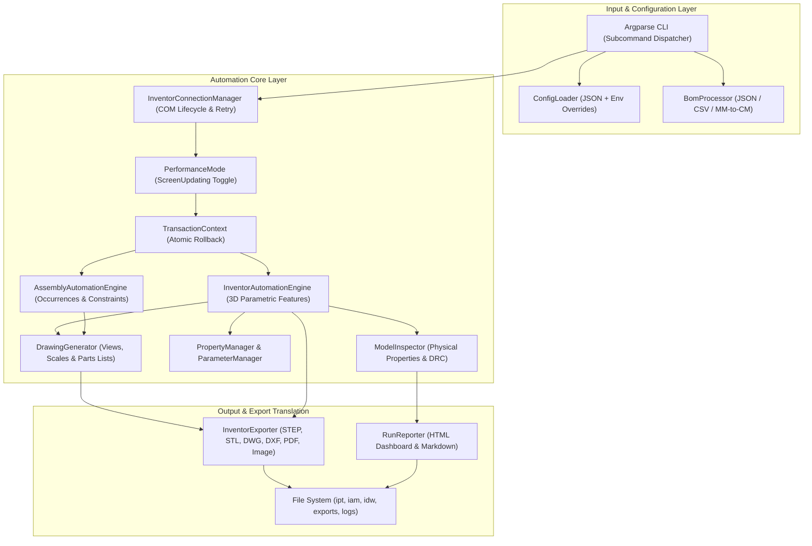

# Autodesk Inventor Automation Engine: System Architecture

## 1. Overview & Architectural Goals

The **Autodesk Inventor Automation Engine** is an enterprise-grade automation framework engineered to bridge modern DevOps workflows (CI/CD runners, scheduled pipelines, REST workers) with Autodesk Inventor's legacy Windows COM API (`Inventor.Application`).

The engine addresses key challenges in programmatic CAD generation:
- **Resilience**: Safe transaction rollbacks (`TransactionContext`) and robust COM error unwrapping (`COMErrorHelper`).
- **Performance**: High-throughput batch processing via `PerformanceMode` (UI suspension and prompt suppression).
- **Flexibility**: Decoupled multi-primitive geometric modeling (`Block`, `Cylinder`, `PlateWithHoles`, `Tube`), unit-aware BOM ingestion, and multi-format CAD translation (`STEP`, `STL`, `DWG`, `DXF`, `PDF`, `PNG`).
- **Quality Assurance**: Automated Design Rule Checking (DRC) and physical mass property extraction (`ModelInspector`).

---

## 2. High-Level Component Topology

---

## 3. Key Design Patterns & Engineering Decisions

### 3.1 COM Lifecycle & Connection Management
Autodesk Inventor is exposed as an out-of-process COM server (`Inventor.Application`). 
- **Attachment First, Creation Second**: `InventorConnectionManager` first invokes `win32com.client.GetObject(Class="Inventor.Application")` to attach to any running instance, preventing unnecessary process overhead.
- **Retry Mechanism**: If attachment fails, it initiates `EnsureDispatch` with exponential backoff retries.
- **Context Manager**: Implements Python's context management protocol (`__enter__` / `__exit__`), ensuring clean reference release and optional termination upon completion.

### 3.2 Atomic Transactions (`TransactionContext`)
CAD operations can fail mid-sketch due to non-manifold geometry, self-intersecting profiles, or invalid parameter inputs. The engine uses Inventor's native `TransactionManager`:
- `StartTransaction(doc, name)` creates a discrete undo state.
- If an unhandled exception occurs, `transaction.Abort()` is executed, restoring the document to its pre-operation state.
- On success, `transaction.End()` commits the feature history cleanly.

### 3.3 Unit Independence & Normalization
Autodesk Inventor's internal database standardizes all length dimensions in **centimeters (cm)** regardless of user display preferences.
- Mechanical engineering BOMs typically specify dimensions in **millimeters (mm)** or **inches (in)**.
- `ConfigLoader.to_cm()` automatically normalizes all user dimensions to internal database units, while preserving user units for drawings and notes.

### 3.4 Multi-Primitive Extensible Engine
The modeling engine (`InventorAutomationEngine`) separates 2D sketch generation, profile creation, and feature extrusions:
- **Primitives**: `create_block`, `create_cylinder`, `create_plate_with_holes`, `create_tube`.
- **Modifications**: `add_fillet`, `add_chamfer`, `create_cut_pocket`.
- **Parametric Equations**: `ParameterManager` binds dimensions to named user parameters for dynamic parametric reconfiguration.

### 3.5 Automated Design Rule Checking (DRC)
`ModelInspector` validates generated models before export:
1. **Geometry Presence**: Verifies `Volume > 0` and non-zero mass.
2. **Aspect Ratio Limit**: Evaluates maximum-to-minimum bounding box dimension ratio to identify unmanufacturable or warped profiles.
3. **Minimum Wall Thickness**: Validates thin-walled features against configured fabrication constraints.

### 3.6 Universal Export Architecture
Inventor utilizes specialized internal translator add-ins identified by GUID/CLSID for high-fidelity vector and 3D conversions:
- **PDF**: `{0AC6DF95-25A1-11D5-8E73-0010B541CD80}`
- **DWG / DXF**: `{C24E3AC2-122E-11D5-8E91-0010B541CD80}`
- **STEP (AP214 / AP203)**: `{90AF203A-3FC1-4883-85FA-630C2918072E}`
- **STL (Additive Manufacturing)**: `{53324084-226B-4895-A446-24E6E342E701}`
- **High-Resolution Snapshot**: `ActiveView.SaveAsBitmap` (up to 4K resolution).

---

## 4. CI/CD & Headless Execution Strategy

Running Autodesk Inventor in automated DevOps pipelines requires consideration of licensing and UI prompts:
1. **Mock Testing**: All unit tests (`pytest`) utilize comprehensive COM interface mocks, allowing full CI/CD execution on headless Linux or Windows runners without requiring an Autodesk Inventor installation.
2. **Silent Operations**: `app.SilentOnSelectSet = True` suppresses modal dialogue alerts that would otherwise hang automated agents.
3. **Screen Updating**: `app.ScreenUpdating = False` disables GPU rendering, yielding up to a 10x throughput improvement for batch runs.
